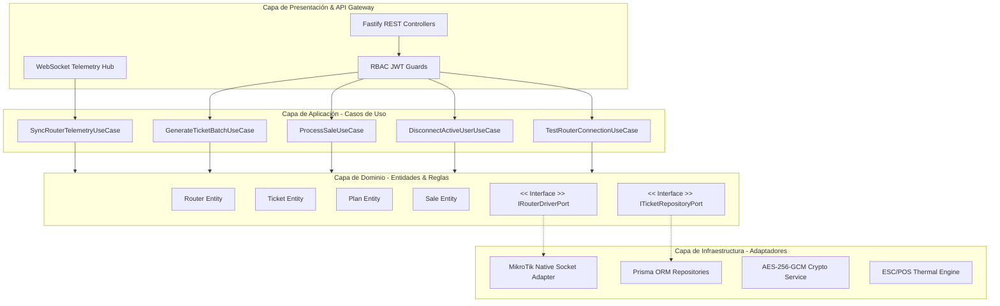
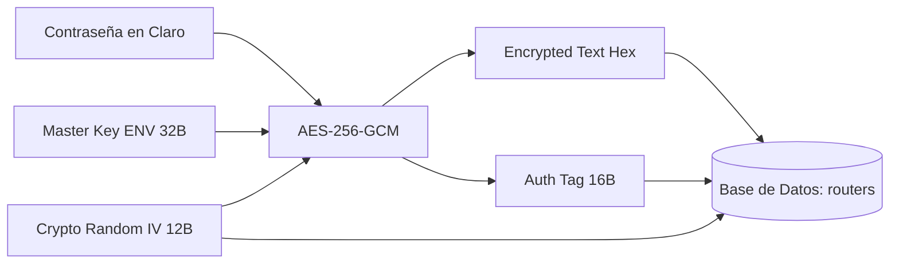

# MikroManager — Documento Maestro de Arquitectura de Software & Especificación Técnica

> [!IMPORTANT]
> **Directriz Fundamental:**
> MikroManager se concibe como una plataforma SaaS / On-Premise de grado de producción para la administración centralizada de redes Hotspot MikroTik RouterOS. No se admiten simulaciones, mocks visuales que aparenten conexión ni APIs inventadas. Cada interacción con el router se realiza a través de su protocolo binario real de sockets (puertos 8728 y 8729 TLS). Las funciones que no cuenten con soporte directo en RouterOS se documentan de forma explícita.

---

## 1. Análisis Exhaustivo de Requisitos y Dominio (ISP / WISP Hotspot)

### 1.1 El Escenario Operativo Real de un WISP / Hotspot Operator
En implementaciones reales en campo, los operadores se enfrentan a escenarios de red heterogéneos y condiciones adversas:
1. **Topologías Híbridas de Conectividad:**
   * **Routers con IP Pública Fija:** Conexión directa mediante socket TCP/TLS.
   * **Routers tras NAT / CGNAT (Módem de fibra del proveedor, 4G/5G, radioenlaces):** No poseen puerto expuesto hacia Internet. MikroManager contempla esquemas de túnel inverso ligero (WireGuard o SSTP cliente en el MikroTik apuntando al servidor MikroManager) o despliegue local (Edge appliance en mini-PC o Raspberry Pi dentro del nodo).
2. **Hardware con Recursos Limitados:**
   * Muchos puntos de acceso son RouterBOARDs de gama de entrada o media (hEX lite, RB750Gr3, hAP ac², RB3011, CCR2004).
   * Un comando masivo descontrolado (ej. inyectar 1,000 usuarios Hotspot en un solo bucle) puede elevar la CPU del router al 100%, provocando pérdida de paquetes, caída del portal cautivo y desconexión masiva de clientes.
3. **El Ciclo de Vida Real del Ticket (Ficha Hotspot):**
   * **Generación:** Creación en base de datos local agrupada por lote (`ticket_batches`) con prefijo identificador.
   * **Inyección en MikroTik:** Registro en `/ip/hotspot/user` con su perfil de velocidad (`rate-limit`), tiempo de conexión (`limit-uptime`) o cuota de datos (`limit-bytes-total`).
   * **Venta (POS):** Transacción con registro de operador, monto, método de pago y emisión de comprobante/ticket térmico o impresión en cuadrícula.
   * **Autenticación (Login):** El cliente se conecta a la red inalámbrica, recibe IP por DHCP, el navegador abre el portal cautivo y envía credenciales mediante POST HTTP a `http://hotspot.local/login`.
   * **Sesión Activa:** El usuario aparece en `/ip/hotspot/active` con su IP, MAC, tiempo transcurrido y bytes transferidos.
   * **Expiración y Retiro:** RouterOS corta el tráfico cuando se agota `limit-uptime` o los bytes. MikroManager sincroniza el estado a `EXPIRED` y ejecuta el saneamiento programado.

```mermaid
flowchart LR
    subgraph POS [Punto de Venta / Admin]
        A[Generador Lote] --> B[(Base de Datos Local)]
        B --> C[Venta POS / Ticket]
        C --> D[Impresión Térmica / QR]
    end

    subgraph Core [MikroManager Core]
        B --> E[MikroTik Engine]
        E -->|Chunks Throttled| F[Circuit Breaker / Socket Pool]
    end

    subgraph RouterOS [MikroTik RouterOS v6/v7]
        F -->|API Port 8728/8729| G[/ip hotspot user]
        G --> H[/ip hotspot active]
        H -->|Expiración / Kick| I[/ip hotspot cookie]
    end

    D -.->|Cliente ingresa PIN| H
```

---

## 2. Propuesta del Stack Tecnológico

| Capa | Tecnología Seleccionada | Justificación Técnica de Arquitectura |
| :--- | :--- | :--- |
| **Backend Runtime** | **Node.js 22 LTS + TypeScript 5.x** | Soporte de sockets TCP nativos no bloqueantes (`net` y `tls`), tipado estricto extremo y compatibilidad a largo plazo. |
| **Framework HTTP / WS** | **Fastify v5** | Entre 2.5x y 3x más rápido que Express en I/O asíncrona; arquitectura de plugins aislados y serialización con JSON Schema ultrarrápida. |
| **Driver MikroTik** | **Driver de Socket Binario Nativo Propio** | Cero dependencias obsoletas; implementación directa de la máquina de estados de palabras y oraciones (sentences) del protocolo MikroTik con multiplexación asíncrona mediante `.tag`. |
| **Base de Datos & ORM** | **PostgreSQL 16 + Prisma ORM** (con soporte SQLite para modo Edge) | Integridad transaccional ACID estricta para ventas, arqueos de caja e inventario de tickets; migraciones declarativas y tipos autogenerados. |
| **Cifrado de Credenciales**| **AES-256-GCM (Node.js `crypto` nativo)** | Autenticación criptográfica con vector de inicialización (IV) de 96 bits y Authentication Tag de 128 bits para contraseñas de routers. |
| **Frontend SPA** | **React 19 + Vite 6** | Rendimiento óptimo en renderizado, arquitectura de componentes modular, carga instantánea y soporte para PWA offline-first en módulos de venta. |
| **Sistema de Diseño / UI** | **Tailwind CSS v4 + Radix UI Primitives** | Interfaz tipo SaaS premium (inspirada en herramientas como Cloudflare/Linear), Dark Mode nativo, accesibilidad total (WAI-ARIA) y diseño responsive adaptable a pantallas táctiles y smartphones. |
| **Gestión de Estado** | **Zustand + TanStack Query v5 (React Query)** | Zustand para estado del cliente (autenticación, router seleccionado, carrito POS); TanStack Query para telemetría, revalidaciones en segundo plano y caché inteligente. |
| **Motor de Impresión** | **ESC/POS Nativo + Web Serial API + PDF Kit** | Generación de comandos binarios directos para impresoras térmicas de tickets (58mm/80mm) y generación de planillas A4/A5 con marcas de corte guillotina. |

---

## 3. Arquitectura del Sistema (Clean / Hexagonal Architecture)

El software se estructura en una **Arquitectura Hexagonal (Ports & Adapters)** para garantizar que la lógica de negocio no dependa de la base de datos ni de las particularidades del protocolo de red de MikroTik.



### Componentes Clave de Infraestructura:
1. **Connection Pool & Circuit Breaker por Router:**
   * Cada router gestiona un pool de sockets TCP/TLS persistentes para evitar el handshake SSL continuo en cada consulta.
   * Si un router no responde tras 3 intentos (timeout de 3000 ms), su Circuit Breaker cambia a estado `OPEN`. Las peticiones fallan inmediatamente con un mensaje amigable ("*El router 'Nodo Norte' está inaccesible temporalmente*") sin degradar las operaciones de los demás routers ni congelar el servidor.
2. **Desacoplamiento de Telemetría (Background Worker):**
   * Las lecturas de CPU, RAM, Uptime y usuarios activos se ejecutan mediante un daemon en segundo plano con intervalos adaptativos (ej. cada 15 segundos en reposo, cada 5 segundos si el dashboard está abierto), transmitiendo los datos al frontend mediante WebSockets.

---

## 4. Estructura de Carpetas del Proyecto (Monorepo Profesional)

```text
MikroManager/
├── apps/
│   ├── api/                           # Backend Fastify + TypeScript
│   │   ├── prisma/
│   │   │   ├── schema.prisma          # Esquema de base de datos relacional
│   │   │   └── migrations/            # Historial de migraciones SQL
│   │   ├── src/
│   │   │   ├── domain/                # Capa de Dominio (Entidades y Contratos)
│   │   │   │   ├── entities/          # Router, Ticket, Plan, Sale, User, Session
│   │   │   │   ├── repositories/      # Interfaces de repositorios (Puertos)
│   │   │   │   └── services/          # Interfaces del Driver MikroTik
│   │   │   ├── application/           # Capa de Aplicación (Casos de Uso)
│   │   │   │   ├── routers/           # TestConnection, SyncStats, CreateRouter
│   │   │   │   ├── tickets/           # GenerateBatch, RevokeTicket, ValidatePin
│   │   │   │   ├── sales/             # ProcessSale, CloseShift, DailySummary
│   │   │   │   └── hotspot/           # KickUser, SyncActiveSessions
│   │   │   ├── infrastructure/        # Capa de Infraestructura (Adaptadores)
│   │   │   │   ├── database/          # PrismaClient y repositorios concretos
│   │   │   │   ├── mikrotik/          # Driver nativo RouterOS API
│   │   │   │   │   ├── protocol/      # SentenceParser, WordEncoder, LengthCodec
│   │   │   │   │   ├── pool/          # ConnectionPool, SocketClient
│   │   │   │   │   ├── resilience/    # CircuitBreaker, RetryPolicy
│   │   │   │   │   └── MikroTikService.ts
│   │   │   │   ├── security/          # AES-256-GCM, BcryptHasher, JWTManager
│   │   │   │   └── printers/          # Driver ESC/POS, Generador de Comandos
│   │   │   ├── presentation/          # Capa de Entrega (HTTP & WebSockets)
│   │   │   │   ├── controllers/       # Controladores REST por módulo
│   │   │   │   ├── middlewares/       # AuthGuard, RBACGuard, RateLimiter
│   │   │   │   ├── schemas/           # Validadores Zod de entrada/salida
│   │   │   │   └── websockets/        # Gateway de telemetría y eventos
│   │   │   ├── config/                # Variables de entorno y constantes
│   │   │   └── server.ts              # Inicialización de Fastify
│   │   ├── package.json
│   │   └── tsconfig.json
│   │
│   └── web/                           # Frontend React 19 + Vite + Tailwind v4
│       ├── public/                    # Assets estáticos, sonidos de alerta, favicon
│       ├── src/
│       │   ├── assets/                # Logos e iconografía SVG
│       │   ├── components/            # Átomos y Moléculas UI reutilizables
│       │   │   ├── ui/                # Botones, Modales, Inputs, Badges, Tabs (Radix)
│       │   │   ├── layout/            # Sidebar, Header, Breadcrumbs, Notifications
│       │   │   └── feedback/          # Toast, ConfirmDialog, EmptyState, Loading
│       │   ├── features/              # Módulos de Negocio Completos
│       │   │   ├── auth/              # Login, Recuperación, Perfil
│       │   │   ├── dashboard/         # Métricas, Gráficas de Tráfico, Salud Nodos
│       │   │   ├── routers/           # Lista, Wizard de Conexión, Monitoreo
│       │   │   ├── plans/             # Tarifas, Límites de Velocidad, Perfiles
│       │   │   ├── tickets/           # Generador, Tabla con Filtros, Diseñador
│       │   │   ├── pos/               # Caja Rápida de Ventas, Arqueo de Turno
│       │   │   ├── hotspot/           # Sesiones en Vivo, Desconexión (Kick), Hosts
│       │   │   ├── captive-portal/    # Editor Visual y Exportador de Templates
│       │   │   ├── reports/           # Filtros Avanzados, Exportación PDF/CSV
│       │   │   ├── operators/         # Gestión de Personal, Asignación de Roles
│       │   │   └── audit/             # Registro de Eventos y Trazabilidad
│       │   ├── hooks/                 # Hooks personalizados (useMikroTik, useDebounce)
│       │   ├── lib/                   # Clientes Axios, ESC/POS Web-Serial, Formatters
│       │   ├── stores/                # Zustand: useAuthStore, useActiveRouterStore
│       │   ├── types/                 # Interfaces TypeScript del Frontend
│       │   ├── App.tsx
│       │   └── main.tsx
│       ├── package.json
│       └── vite.config.ts
│
├── packages/
│   └── shared-types/                  # DTOs, Enums y Contratos compartidos
│       ├── index.ts
│       └── package.json
│
├── docker-compose.yml                 # Despliegue con un solo comando
└── README.md
```

---

## 5. Diseño del Modelo de Base de Datos Relacional

Se implementan llaves foráneas estrictas, índices `btree` en campos de búsqueda frecuente y restricciones de unicidad compuestas:

```mermaid
erDiagram
    USERS ||--o{ SALES : "realiza"
    USERS ||--o{ AUDIT_LOGS : "genera"
    ROUTERS ||--o{ HOTSPOT_PROFILES : "posee"
    ROUTERS ||--o{ TICKET_BATCHES : "contiene"
    ROUTERS ||--o{ SESSIONS : "registra"
    HOTSPOT_PROFILES ||--o{ PLANS : "asigna_a"
    PLANS ||--o{ TICKET_BATCHES : "configura"
    TICKET_BATCHES ||--o{ TICKETS : "agrupa"
    TICKETS ||--o| SALE_ITEMS : "incluido_en"
    SALES ||--|{ SALE_ITEMS : "contiene"
    CUSTOMERS ||--o{ TICKETS : "adquiere"

    USERS {
        uuid id PK
        string username UK
        string email UK
        string password_hash
        enum role "SUPERADMIN | ADMIN | OPERADOR | CONSULTA"
        boolean is_active
        timestamp created_at
    }

    ROUTERS {
        uuid id PK
        string name
        string host
        int api_port
        boolean use_ssl
        string username
        string encrypted_password
        string iv
        string auth_tag
        string ros_version
        string identity
        enum status "ONLINE | OFFLINE | ERROR | UNCHECKED"
        timestamp last_seen_at
    }

    PLANS {
        uuid id PK
        string name
        decimal price
        int duration_seconds
        int download_speed_kbps
        int upload_speed_kbps
        bigint data_limit_bytes
        int shared_users
        uuid router_id FK
        string hotspot_profile_name
    }

    TICKETS {
        uuid id PK
        uuid batch_id FK
        uuid router_id FK
        uuid plan_id FK
        string username UK
        string password
        enum status "AVAILABLE | RESERVED | SOLD | ACTIVE | EXPIRED | DISABLED"
        timestamp activated_at
        timestamp expires_at
        timestamp created_at
    }

    SALES {
        uuid id PK
        uuid user_id FK
        uuid router_id FK
        decimal total_amount
        enum payment_method "CASH | TRANSFER | CARD | OTHER"
        timestamp created_at
    }

    SALE_ITEMS {
        uuid id PK
        uuid sale_id FK
        uuid ticket_id FK UK
        decimal unit_price
    }

    SESSIONS {
        uuid id PK
        uuid router_id FK
        string username
        string ip_address
        string mac_address
        int uptime_seconds
        bigint bytes_in
        bigint bytes_out
        timestamp started_at
        timestamp ended_at
    }
```

### Tabla de Restricciones e Índices Críticos:
* `tickets`: `UNIQUE(router_id, username)` para garantizar que ningún ticket generado colisione dentro del mismo MikroTik. Índice en `status` y `expires_at`.
* `routers`: Restricción de verificación `CHECK (api_port > 0 AND api_port <= 65535)`.
* `sales`: Índice compuesto en `(created_at, user_id)` para acelerar los reportes de corte de caja diarios.
* `sessions`: Índice en `mac_address` para consulta de historial por cliente físico.

---

## 6. Flujo de Comunicación y Mecánica de la API de RouterOS

### 6.1 Codificación Binaria de Longitud de Palabras (Word Length Encoding)
El protocolo de RouterOS API no utiliza terminadores JSON ni líneas de texto simple. Se estructura en oraciones compuestas por palabras. Cada palabra inicia con un prefijo que define su longitud en bytes:
* Si la longitud es **$< 128$ bytes ($0x80$):** Se envía en **1 byte** directo.
* Si es **$< 16,384$ bytes ($0x4000$):** Se envía en **2 bytes**, con los bits más significativos marcados con `0x80` (`length | 0x8000`).
* Si es **$< 2,097,152$ bytes ($0x200000$):** Se envía en **3 bytes** (`length | 0xC00000`).
* Si es **$< 268,435,456$ bytes ($0x10000000$):** Se envía en **4 bytes** (`length | 0xE0000000`).
* Cada oración finaliza con un byte nulo (`0x00`).

### 6.2 Multiplexación Asíncrona con el Atributo `.tag`
Para que un solo socket persistente procese múltiples peticiones en paralelo (ej. un hilo consultando telemetría mientras otro hilo inyecta una ficha vendida), MikroManager incluye un identificador único en cada solicitud:
```text
>>> /system/resource/print
>>> =.tag=req_telemetry_9812
>>> [0x00]
```
RouterOS procesa la consulta y responde con el mismo identificador:
```text
<<< !re
<<< =.tag=req_telemetry_9812
<<< =cpu-load=4
<<< =free-memory=118489088
<<< [0x00]
<<< !done
<<< =.tag=req_telemetry_9812
<<< [0x00]
```
El motor de MikroManager intercepta el tag y resuelve la promesa correspondiente en memoria sin interferir con otras operaciones.

---

## 7. Matriz de Comandos Reales RouterOS API vs MikroManager

| Función en MikroManager | Comando RouterOS Real | Argumentos / Atributos Enviados | Respuesta Esperada | Manejo de Error y Fallback | Compatibilidad |
| :--- | :--- | :--- | :--- | :--- | :--- |
| **Prueba de Conexión** | `/system/identity/print` | Ninguno | `!re =name=...` seguido de `!done` | Timeout de 3s; captura error de login `!trap =message=cannot log in` | ROS v6.43+ / v7.x |
| **Telemetría de Hardware** | `/system/resource/print` | Ninguno | `!re =uptime=... =cpu-load=... =free-memory=...` | Si el comando falla, marcar estado del router como DEGRADED | ROS v6.43+ / v7.x |
| **Crear Perfil Hotspot** | `/ip/hotspot/user/profile/add` | `=name=PLAN_2H`<br>`=rate-limit=5M/2M`<br>`=shared-users=1` | `!done =ret=*ID` | Capturar `!trap =message=failure: already have...` si el nombre ya existe | ROS v6.43+ / v7.x |
| **Inyectar Usuario/Ticket** | `/ip/hotspot/user/add` | `=server=all`<br>`=profile=PLAN_2H`<br>`=name=PIN4891`<br>`=password=4891`<br>`=limit-uptime=2h` | `!done =ret=*ID` | Si devuelve `!trap` por duplicado, el generador reintenta con otro PIN automáticamente | ROS v6.43+ / v7.x |
| **Desactivar Ticket** | `/ip/hotspot/user/set` | `=.id=*ID_ROUTEROS`<br>`=disabled=yes` | `!done` | Si el ID en MikroTik no existe, marcarlo como desincronizado en BD | ROS v6.43+ / v7.x |
| **Eliminar Ticket** | `/ip/hotspot/user/remove` | `=.id=*ID_ROUTEROS` | `!done` | Ignora `no such item` y remueve de la base de datos | ROS v6.43+ / v7.x |
| **Consultar Conectados** | `/ip/hotspot/active/print` | Opcional: `?user=PIN4891` | Secuencia de `!re` con `=user=... =address=... =mac-address=... =uptime=...` | Si retorna vacío, la lista activa queda en 0 | ROS v6.43+ / v7.x |
| **Expulsar Sesión (Kick)** | `/ip/hotspot/active/remove` | `=.id=*ID_ACTIVO` | `!done` | Corta la conexión en Capa 2/3 de forma inmediata | ROS v6.43+ / v7.x |
| **Monitorear Tráfico** | `/interface/monitor-traffic` | `=interface=ether1`<br>`=once=` | `!re =rx-bits-per-second=... =tx-bits-per-second=...` | Se ejecuta con `=once=` para evitar sockets continuos bloqueantes | ROS v6.43+ / v7.x |

---

## 8. Identificación de Riesgos Técnicos y Mitigaciones

### Riesgo 1: Saturación de CPU en MikroTik por Lotes Masivos
* **Problema:** Si un usuario solicita 500 tickets y se envían 500 comandos `/ip/hotspot/user/add` en una ráfaga asíncrona descontrolada, el proceso `system` de RouterOS alcanzará el 100% de uso de CPU, provocando timeouts en los clientes Wi-Fi.
* **Mitigación:** Implementación del patrón **Throttled Batch Ingestion**. El backend procesa los lotes en bloques de **20 usuarios**, esperando **50 ms** entre cada bloque y verificando el estado del socket antes de proceder.

### Riesgo 2: Routers tras NAT / Conexiones Inestables
* **Problema:** El servidor MikroManager alojado en un VPS no puede abrir sockets hacia una IP privada de tipo `192.168.88.1` o IPs bajo Carrier-Grade NAT (CGNAT).
* **Mitigación:** 
  1. Soporte de **túneles WireGuard / SSTP integrados**, donde el MikroTik actúa como cliente y se conecta a la red privada segura de MikroManager.
  2. Arquitectura de despliegue **On-Premise (Local)** para entornos donde una mini-PC se ubica en la misma LAN del router.

### Riesgo 3: MAC Address Aleatoria en Dispositivos Modernos (iOS / Android)
* **Problema:** Los teléfonos modernos cambian su dirección MAC periódicamente o al reconectarse a la red Wi-Fi. Si el perfil Hotspot amarra la sesión a la MAC (`mac-cookie`), el usuario puede perder su tiempo o ser desconectado.
* **Mitigación:** En los perfiles generados por MikroManager, se configura `shared-users=1` con validación estricta por credencial (Usuario/PIN), desacoplando la permanencia del ticket de una MAC fija no garantizada.

### Riesgo 4: Desincronización Manual por Uso de Winbox
* **Problema:** Un administrador entra directamente por Winbox y borra o modifica usuarios creados por MikroManager.
* **Mitigación:** Tarea periódica de **Reconciliación de Estado** (State Reconciliation Job) que compara los IDs de MikroTik con la base de datos local y marca con bandera `ORPHAN` o actualiza los estados inconsistentes.

---

## 9. Análisis de Funcionalidades Dependientes de RouterOS

### Modos de Validez del Ticket:
RouterOS provee nativamente en `/ip/hotspot/user`:
* `limit-uptime`: Descuenta únicamente el tiempo en el que el usuario está **activamente conectado**. Si un usuario compra 2 horas y se desconecta a los 30 minutos, le restan 1 hora y media indefinidamente.
* `limit-bytes-total`: Descuenta megabytes transferidos totales (subida + bajada).

> [!NOTE]
> **Caducidad Calendario Fija (Reloj de Pared):**
> Si se desea un plan de "24 horas corridas" que expire exactamente 24 horas después de su primer inicio de sesión (incluso si el usuario apaga el Wi-Fi), RouterOS **no** posee un parámetro nativo en `/ip/hotspot/user` para esto sin scripts auxiliares.
>
> **Solución Arquitectónica de MikroManager:**
> 1. Al crear el perfil Hotspot, se inyecta un script en el evento `on-login` del perfil que registra la fecha/hora en los comentarios del usuario.
> 2. El worker de MikroManager evalúa las fechas de activación y remueve el usuario cuando la fecha de expiración se cumple, o bien se delega a un `/system scheduler` interno del router.

---

## 10. Implementación de la Conexión API / API-SSL y Criptografía

### Mecánica de Conexión:
* **Puerto Estándar (8728):** Socket TCP binario directo sin cifrado TLS (recomendado solo para LAN interna).
* **Puerto API-SSL (8729):** Socket TLS (`tls.connect`) con cifrado de canal punto a punto. Para certificados autofirmados generados por RouterOS, el cliente permite configurar el modo de verificación estricto o con CA personalizada para evitar ataques Man-In-The-Middle.

### Autenticación v6.43+ y RouterOS v7:
* El protocolo moderno envía las credenciales de forma directa tras la apertura del socket seguro:
  ```text
  >>> /login
  >>> =name=admin
  >>> =password=ClaveSecreta
  <<< !done
  ```
  *(El esquema antiguo de hash MD5 de versiones anteriores a v6.43 está obsoleto y se descarta).*

### Cifrado de Credenciales en Reposo (AES-256-GCM):

* **Master Key:** Variable de entorno `MIKROMANAGER_ENCRYPTION_KEY` de 32 bytes (256 bits).
* **IV:** Vector aleatorio de 12 bytes generado en cada actualización de router (`crypto.randomBytes(12)`).
* **Auth Tag:** Tag de autenticación de 16 bytes que valida la integridad del registro en la base de datos contra alteraciones.

---

## 11. Hoja de Ruta de Desarrollo por Fases (Roadmap)

El desarrollo del proyecto se ejecutará de forma metódica en **17 fases secuenciales**:

```text
[Fase 1] Base y Arquitectura del Monorepo
    └── [Fase 2] Modelado y Migraciones de Base de Datos
        └── [Fase 3] Autenticación, Usuarios y RBAC
            └── [Fase 4] Dashboard de Telemetría y KPIs
                └── [Fase 5] Driver MikroTik API Capa 7 (Socket & Circuit Breaker)
                    └── [Fase 6] Módulo de Routers (CRUD y Hardware Status)
                        └── [Fase 7] Planes y Mapeo de Perfiles Hotspot
                            └── [Fase 8] Generador Masivo de Tickets y Algoritmo Anti-Colisión
                                └── [Fase 9] Módulo de Ventas y Caja Rápida (POS)
                                    └── [Fase 10] Gestión de Operadores y Arqueo de Turnos
                                        └── [Fase 11] Gestión de Hotspot en Vivo (Active Users & Kick)
                                            └── [Fase 12] Editor y Exportador de Portal Cautivo
                                                └── [Fase 13] Reportes Ejecutivos y Exportación (PDF/CSV)
                                                    └── [Fase 14] Motor de Impresión ESC/POS y Planillas A4/A5
                                                        └── [Fase 15] Hardening de Seguridad y Auditoría
                                                            └── [Fase 16] Suite de Pruebas Unitarias y de Integración
                                                                └── [Fase 17] Empaquetado Docker y Manual de Puesta a Punto
```

---

## 12. Guía de Aprovisionamiento Seguro en MikroTik RouterOS

Para conectar MikroManager a un router MikroTik en producción de forma segura y con permisos mínimos, se debe ejecutar el siguiente script en la terminal de RouterOS:

```routeros
# ==============================================================================
# SCRIPT DE APROVISIONAMIENTO OFICIAL PARA MIKROMANAGER
# ==============================================================================

# 1. Crear grupo de permisos estrictos (Sin acceso a FTP, Winbox ni políticas críticas)
/user group add name=mikromanager-group \
    policy=api,read,write,test,!ftp,!reboot,!policy,!password,!winbox,!web

# 2. Crear usuario específico para la plataforma
/user add name=mikromanager \
    group=mikromanager-group \
    password="CAMBIAR_POR_PASSWORD_ROBUSTO_2026" \
    comment="Usuario de servicio gestionado por MikroManager"

# 3. Habilitar el servicio API y API-SSL
/ip service set api disabled=no port=8728
/ip service set api-ssl disabled=no port=8729

# 4. Proteger los puertos de la API en el Firewall (Permitir únicamente la IP del servidor MikroManager)
/ip firewall filter add chain=input protocol=tcp dst-port=8728,8729 \
    src-address=IP_DEL_SERVIDOR_MIKROMANAGER action=accept \
    comment="MikroManager: Permitir acceso API unicamente al servidor central"

# 5. Bloquear cualquier otro intento de conexión a la API desde Internet o redes externas
/ip firewall filter add chain=input protocol=tcp dst-port=8728,8729 \
    action=drop comment="MikroManager: Bloquear intentos no autorizados a la API"
```
